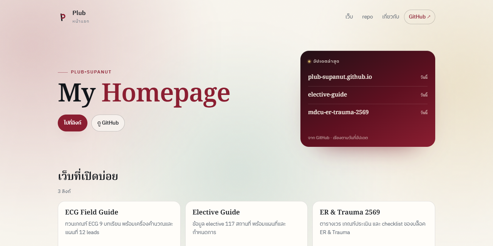

<div align="center">
  
  <h1>Plub</h1>
  <p><strong>รวมลิงก์ที่ใช้บ่อยและ repo ล่าสุด</strong> — หน้าเดียวสำหรับเปิดใช้งานจริง</p>
  <p>
    <a href="https://plub-supanut.github.io/"></a>
    <a href="https://github.com/Plub-Supanut/plub-supanut.github.io/commits/main"></a>
    
  </p>
  <p>
    <a href="https://plub-supanut.github.io/"><strong>เปิดเว็บ</strong></a>
    &nbsp;·&nbsp;
    <a href="https://github.com/Plub-Supanut/plub-standard/blob/main/GITHUB_STANDARD.md">Project standard</a>
    &nbsp;·&nbsp;
    <a href="https://github.com/Plub-Supanut">GitHub</a>
  </p>
</div>

---

## Overview

หน้าแรกส่วนตัวของ **Plub** — รวมลิงก์ที่เปิดบ่อย (ECG Field Guide, Elective Guide, ER & Trauma) และรายการ repo จาก GitHub ไว้หน้าเดียว

ตัวหน้าเว็บเป็น static ล้วน ไม่มี build step, ไม่มี dependency และไม่เก็บข้อมูลผู้ใช้ — เปิดจากมือถือหรือคอมได้ทันที

## Features

- **ลิงก์ที่ใช้บ่อย** — การ์ด 3 ใบ เปิดเว็บได้ตรง ไม่ต้องจำ URL
- **repo ล่าสุด** — ดึงจาก GitHub API ทุกครั้งที่เปิดหน้า กรอง fork/archived ออก
- **ค้นหา repo** — พิมพ์ชื่อหรือคำอธิบายเพื่อกรองได้ทันที
- **อัปเดตล่าสุด** — แสดง 3 repo ที่เพิ่งอัปเดต ในแผงด้านขวา
- **เบาและเร็ว** — ไฟล์ HTML เดียว + assets ไม่มี framework
- **พื้นหลัง dynamic** — orbs เคลื่อนไหวช้า ๆ และขยับตามเมาส์ (หยุดอัตโนมัติเมื่อระบบตั้งค่า reduced motion)
- **รองรับ dark mode** — ตามการตั้งค่าระบบ

## Screenshot



## Project structure

```text
index.html      หน้าเว็บหลัก (HTML + CSS + JS)
ecg/            สำเนา ECG Field Guide สำหรับเปิดออนไลน์
assets/         รูป preview
404.html        หน้า not found
robots.txt      robots
.nojekyll       ปิด Jekyll บน GitHub Pages
README.md       ไฟล์นี้
```

## Development

ไม่ต้องติดตั้งอะไร:

```bash
python -m http.server 8777
# เปิด http://127.0.0.1:8777
```

แก้ `index.html` ได้เลย — repo list มาจาก GitHub API จึงไม่ต้องแก้ไฟล์เมื่อมี repo ใหม่

## Standard

โปรเจกต์นี้ทำตาม [Plub-Supanut Project Standard](https://github.com/Plub-Supanut/plub-standard/blob/main/GITHUB_STANDARD.md) — README, metadata, release และ CI

## License

โค้ดของหน้านี้ © 2026 Plub-Supanut · เนื้อหาของแต่ละเว็บมีลิขสิทธิ์ตาม repo ต้นทาง
